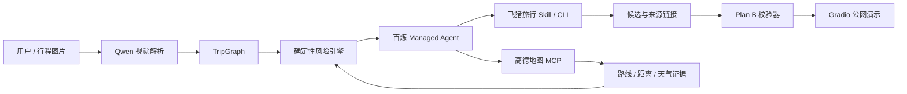

---
# ModelScope Studio card metadata
domain: multi-modal
tags:
- Agent
- AI旅行
- 百炼
- 飞猪旅行
- 高德地图MCP
- Gradio
- TripGraph
datasets:
  evaluation:
  test:
  train:
models:
license: MIT License
---

# 途证哨 TuzhengGuard · 旅行数字孪生守护者

“途”是旅行，“证”是可追溯证据，“哨”是风险守护。项目现使用 `TuzhengGuard` 作为对外英文标识；改名范围与兼容说明见 [名称迁移记录](docs/name-migration.md)。

途证哨 将零散行程解析为结构化 `TripGraph`，使用确定性规则发现时间、日期、预算、体力和天气风险，再基于飞猪旅行真实候选生成可验证的 Plan B。它只做风险提示与候选推荐，**不会自动预订或支付**。

> 当前状态：持续维护的公开版本；[GitHub 公共仓库](https://github.com/amazingLH/tuzhengguard-travel-guardian)与 [ModelScope 公网 Demo](https://modelscope.cn/studios/L666H666Better/triptwin-travel-guardian)均已发布。

## 功能亮点

- **旅行数字孪生**：把车次、酒店、景点、同行人和约束统一为可计算的 TripGraph。
- **确定性风险引擎**：风险结论来自显式规则和证据，不让模型自由编造。
- **真实工具闭环**：百炼 Managed Agent 调用飞猪旅行 Skill/CLI 与高德地图 MCP。
- **受约束的 Plan B**：候选必须属于当前行程、总增量不超限、受保护订单不变，并通过 TripGraph 回放复检。
- **真实巡检**：用户行程使用独立 Managed Agent 会话实时调用高德 MCP 与 FlyAI；失败时停止，不借用示例结果。
- **隐私与可追溯**：密钥不入库；原始上传图片不进入浏览器历史；页面明确数据时效和未核验范围。
- **可落地交互**：支持 1–5 张截图合并、结构化校对、独立会话切换、重命名与删除，以及 JSON/ICS 导出。
- **解析后人工确认**：用户截图先生成草稿，缺少的日期、地点、价格等必要参数需补全，预算、人数与规则需确认；确认成功后才构建 TripGraph 并进入后续操作。已退票/取消订单显示原因并阻止构建有效出行计划。导入截图按纵向列表展示，支持框内滚动、悬停显示文件名及一键清空。
- **多图覆盖校验**：多张截图仍在一次请求中处理，但模型必须逐图返回独立结果；程序校验图片编号和对应事件，再合并行程。同一出发时间而目的地不同的车票不会去重。漏图或无法识别时停止构建，指出图片编号，不以残缺结果报告“0 风险”。旧多图历史须重新解析后再分析。编号覆盖校验不是字段正确率保证，仍需人工核对。
- **三组功能示例**：杭州完整行程、两段正常铁路衔接、三段冲突铁路行程。铁路示例来自所提供的脱敏车票截图，字段由人工核对，预算/人数为演示设置；示例解析与冲突分析不调用模型，不冒充实时高德或 FlyAI 结果。
- **可应用的局部 Plan B**：对可通过移除非受保护冲突项解决的时间冲突，枚举多个方案、重新校验依赖与预算、回放风险并展示比较表；用户选择后更新页面行程、时间线和风险，不执行实际订单退改。无法在本地解决或需要新供给的情况继续走真实工具链路。

## 架构



LLM 负责理解、编排和解释；TripGraph、风险规则、候选校验与证据文件负责约束结果。

## 验证与交互

左侧深色会话工作台分为当前会话与历史会话两部分，分隔线区分；每条会话右侧的三个点菜单支持重命名和删除。当前会话不重复出现在历史列表中，手动名称不会被自动保存覆盖；删除历史记录不会切走当前会话。桌面常驻展示，手机可收起为抽屉。标题区的旅行机器人与轨道动效使用本地 CSS 绘制，遵循系统的减少动态效果设置。

自动化回归覆盖多图完整性、风险检查、局部方案、会话恢复和 API 失败提示。历史真实工具证据与离线功能示例分别标注来源，不将示例结果视为实时查询。

## 会话问答

“途证哨智能回复”结合当前会话的行程与解析草稿、字段置信度、风险和工具证据、原方案、Plan B 候选与应用记录、先前页面结果及对话历史回答，每次最多 300 字。应用局部 Plan B 后保留原 Plan A 和候选比较记录，聊天不会被清空；刷新或切换回来后可继续追问旧方案。模型对未提供的酒店、天气、库存、退款政策等信息明确说明未知。

新问题统一调用文本模型，不再使用固定示例答案绕过 LLM；同一会话、相同内容和相同对话背景下的重复问题可复用缓存。缓存区分会话与上下文，模型故障回复不缓存。服务明确报免费额度耗尽时，页面会显示额度与模型配置提示，不将故障当成成功完成。

文本模型默认 `qwen-plus`，可通过 `DASHSCOPE_TEXT_MODEL` 覆盖。若模型开启“免费额度用完即停”，免费额度耗尽后会被上游拒绝，即使应用仍有每日次数也无法继续调用；维护者应在百炼控制台检查对应模型的用量设置或更换可用模型。账户欠费与普通网络/权限错误分别提示。

## 本地运行

要求 Python 3.11+。

请使用项目虚拟环境，并安装 `requirements.txt` 中的固定版本；不要直接混用电脑上其他项目的 Gradio 环境。若未激活虚拟环境，也可直接执行 `.\.venv\Scripts\python.exe app.py` 或 `.\.venv\Scripts\python.exe -m pytest -q`。

```powershell
python -m venv .venv
.\.venv\Scripts\Activate.ps1
pip install -r requirements.txt
Copy-Item .env.example .env
```

在 `.env` 中配置自己的凭据：

```text
DASHSCOPE_API_KEY=
FLYAI_API_KEY=
BAILIAN_WORKSPACE_ID=
BAILIAN_AGENT_ID=
BAILIAN_ENVIRONMENT_ID=
DASHSCOPE_TEXT_MODEL=qwen-plus
DASHSCOPE_VISION_MODEL=qwen3-vl-plus
```

每天按北京时间重置：每个浏览器最多 100 次提问、100 次自行上传图片解析，每位访客最多 100 次实时高德/FlyAI 核验。三类服务均无全站每日次数上限。重复问题及有效实时证据会复用缓存；本地示例的导入、解析与确定性风险检查不调用模型；所有自由提问（包括示例问题）均由 LLM 回答，使用相同的每日提问额度。

额度策略固定在服务端，旧版 `TRIPTWIN_*_LIMIT` 环境变量不再生效。若上游明确返回余额不足或欠费，页面会提示“该站后台大模型 API 余额不足或已欠费”，保留已有结果；网络超时、权限错误与普通限速不会误报欠费，错误提示不进入回答缓存。

```text
TRIPTWIN_BROWSER_STATE_SECRET=请生成至少32字节随机值
TRIPTWIN_RATE_LIMIT_SALT=请生成另一段至少32字节随机值
TRIPTWIN_USAGE_COUNTER_PATH=/tmp/triptwin-usage.sqlite3
```

然后启动：

```powershell
python app.py
```

默认监听 `0.0.0.0:7860`，本机访问 `http://127.0.0.1:7860/`。

## 测试

```powershell
python -m pytest -q
```

测试覆盖 TripGraph 引用与依赖环、时间重叠、风险规则、跨行程候选阻断、总预算与回放校验、百炼事件解析、密钥脱敏、动态问答、多会话隔离、高德证据与 Deployment 展示。另可运行 `python scripts/evaluate_offline.py` 执行凭据无关的发布验收。

## ModelScope Studio 部署

本项目使用 Gradio，根目录包含 `app.py`、`requirements.txt` 和 `ms_deploy.json`。在创空间的 **Secret/密钥** 配置中添加以下名称，不要把真实值写入代码或普通公开变量：

```text
DASHSCOPE_API_KEY
FLYAI_API_KEY
BAILIAN_WORKSPACE_ID
BAILIAN_AGENT_ID
BAILIAN_ENVIRONMENT_ID
TRIPTWIN_BROWSER_STATE_SECRET
TRIPTWIN_RATE_LIMIT_SALT
```

模型名称不是密钥，可按需在普通环境变量中覆盖；文本问答默认使用 `qwen-plus`，视觉解析默认使用 `qwen3-vl-plus`：

```text
DASHSCOPE_TEXT_MODEL=qwen-plus
DASHSCOPE_VISION_MODEL=qwen3-vl-plus
```

模型额度设置请进入[百炼华北2（北京）免费额度页面](https://bailian.console.aliyun.com/cn-beijing/costing-balance/free-quota)，按模型 Code 搜索 `qwen-plus` 与 `qwen3-vl-plus`。若列表未显示，可从[模型广场](https://bailian.console.aliyun.com/model/market)进入对应模型详情并选择匹配的 Code/版本；额度过期、耗尽、地域与筛选状态都可能影响显示，不能仅凭搜索不到判断模型不存在。未认证账号无法关闭“免费额度用完即停”；已认证账号可按控制台设置管理。详见[官方说明](https://help.aliyun.com/zh/model-studio/new-free-quota)。

部署完成后必须使用无痕窗口和手机网络分别测试，并确认运行日志不包含凭据。

## 数据与能力边界

- 候选价格、库存、天气和交通结果都有时效性，页面展示的是对应获取时间的证据。
- 高德地理编码可能返回行政区级结果；精度不足时会明确告警，不冒充精确 POI。
- 浏览器历史仅保存在当前浏览器，最多 20 个会话；点击左侧历史卡片后自动恢复行程、解析草稿、未提交补全、风险、Plan B、对话和小尺寸截图预览。预览也可能含隐私信息，请勿在共享浏览器留存个人订单；支持通过每条会话右侧菜单重命名或删除，不提供跨设备账户历史。原图不写入历史；旧版本未保存的截图需重新上传。
- 未配置密钥时，本地启动会在用户应用数据目录保留历史加密密钥，重启不再随机换钥。创空间仍须配置并保持 `TRIPTWIN_BROWSER_STATE_SECRET` 和 `TRIPTWIN_RATE_LIMIT_SALT` 不变，否则容器重建或换钥后无法读取旧历史。
- 上传原图会发送至百炼解析，应用不会自动给画面打码；临时上传和导出文件约 1–2 小时后清理。历史会话恢复文件名称列表与预览：原图仍有效时可重新解析，正常计入额度；原图过期时，点击解析复用该会话已有解析，不将低清预览当成原图发送给模型，保留风险、Plan B 和聊天。尚未解析或需要重新识别时需重传原图。临时文件引用经服务端签名及内容哈希校验，不接受任意本地路径。JSON/ICS 导出相互隔离，日历使用明确 UTC 时间。
- 公开站点中的自由问答、用户自传图片解析，以及用户行程的实时高德/FlyAI 核验会使用部署者额度；合成示例与本地确定性风险检查不调用模型。
- 限流计数使用 SQLite 原子事务，匿名访客标识只保存加盐哈希，不保存 IP、问题或图片；容器重建会清空本地计数，全站调用持续开放至上游账户无法提供服务。
- 本地文件错误不扣解析次数；已发出的云端请求即使失败也可能计费，保留服务端次数，避免反复重试绕过保护。任务超时会尝试请求中断，但不能保证平台立即停止。
- 实时证据在 1 小时内复用；过期再次执行仍受每日额度限制。网页不为每位用户自动定时巡检；公开 Scheduled Task 记录属于历史演示。
- 真实候选必须对应本次成功 CLI 输出的名称、来源链接与单一价格。没有价格、只有区间价或证据不足时拒绝确认方案；不编造余票、费用或退改政策。
- 用户上传行程若没有当前会话的实时候选证据，系统不会展示公开杭州案例的 Plan B 或工具轨迹。
- 作品不执行预订、支付、退改或订单操作。
- `examples/` 与杭州图片为合成数据；三张铁路功能示例是获用户授权的脱敏订单素材，非纯合成图，预算/人数是明确的演示设置。

## 目录

```text
app.py                      Gradio 入口
src/triptwin/               TripGraph、风险、Agent 与展示服务
tests/                      自动化测试
evals/                      离线发布验收清单
examples/                   合成黄金行程
assets/                     合成杭州图片与脱敏铁路示例
docs/evidence/              脱敏的真实调用证据
docs/stage6-validation-report.md
```

## 演示与验证

项目提供公开在线演示、行程冲突处理截图及真实工具调用证据；本地功能示例与历史云端查询分别标注来源和验证范围。2026-10-14 的历史截图基线为 `5a23154`；当前交互与额度策略见上文。

- [最新公网运行截图](docs/evidence/stage8-public/README.md)：行程、重叠风险、两个 Plan B 与应用后复检；明确为本地功能示例。
- [TripGraph 与风险引擎](docs/tripgraph-and-risk-engine.md)：结构化行程模型、约束和风险规则。
- [集成验证报告](docs/stage6-validation-report.md)：工具链路、会话隔离与部署验证。

## License

项目原创代码采用 [MIT License](LICENSE)。`skills/triptwin-flyai/` 保留其原始 MIT 许可证与版权声明。

